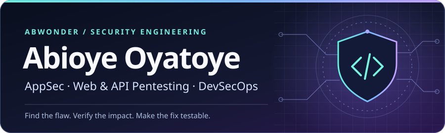

# Abioye Oyatoye

  

I test web applications and APIs, reproduce attack paths, and work with engineering teams on fixes they can verify. My DevSecOps work covers cloud hardening, monitoring, and security automation.

**Start here:** [Featured projects](#featured-projects) · [Languages](#languages) · [Security tools](#security-tools) · [Infrastructure](#technologies--infrastructure) · [GitHub statistics](#github-statistics)

## 📌 Featured Projects

| Project | What you can inspect | Focus |
| :--- | :--- | :--- |
| [Security Writeups](https://github.com/Abwonder/security-writeups) | A React, Node.js, and Supabase attack chain and an AES-CBC padding oracle walkthrough. | AppSec research |
| [API Pentest Lab Setup](https://github.com/Abwonder/APIsec_pentest_labsetup) | Bash scripts that set up a Kali lab with tools for endpoint discovery, API requests, and JWT testing. | API security |
| [DevSecOps Portfolio](https://github.com/Abwonder/Abioye-DevSecOps-Projects) | A web cache poisoning lab using Vagrant, Nginx, Varnish, and HAProxy. | Web security lab |
| [Docs as Code Lab](https://github.com/Abwonder/docs-as-code-lab) | A fictional incident intake API with runnable examples, contract tests, and GitHub Actions deployment. | CI/CD & developer tooling |

## 🔎 Work in Practice

- **Application security:** Assessed **148 endpoints across 23 API groups** against the OWASP API Security Top 10, testing authorization, JWT handling, rate limits, and payment flows. Also reviewed session management and real-time messaging for a telehealth platform.
- **Cloud hardening:** Designed WAF and firewall rules and hardening for Docker registries, SSH, and Redis on DigitalOcean and Cloudflare. Built Datadog synthetic checks and wrote incident runbooks.
- **Security automation:** At CyberSOC Africa, built a Python and Selenium workflow that captured outage evidence in SharePoint and automatically opened incident tickets. Also built an email impersonation monitoring workflow.
- **Technical documentation:** At Reclear, I write developer guides on infrastructure, security, and AI governance, including how to make agent activity auditable.

## 💻 Languages

**Automation:** Python · Bash · PowerShell · **Data and queries:** SQL · R · **Development:** JavaScript · Java · HTML · CSS

## 🧰 Security Tools

     

**Web & API:** Burp Suite, ZAP, Nuclei, Postman, JWT testing, OWASP Web and API Top 10  
**Recon, network & secrets:** Nmap, Wireshark, Gitleaks, TruffleHog  
**Lab & training:** Kali Linux, Metasploit, Shodan, Arjun, Kiterunner, JWT Tool

## ⚙️ Technologies & Infrastructure

### Development

**Application stacks:** Node.js, React, Next.js, Django, Supabase/PostgreSQL, Stripe, WebRTC, and Socket.IO in development or assessment work.

### DevSecOps & Infrastructure

- **Cloud and hardening:** DigitalOcean, Cloudflare WAF, Docker registries, Linux, SSH, and Redis.
- **Monitoring and automation:** Datadog, Selenium, Microsoft Sentinel/KQL, SharePoint, and Jira.
- **Public labs and CI:** GitHub Actions, GitHub Pages, Docusaurus, Vagrant, Nginx, Varnish, and HAProxy.

## 📊 GitHub Statistics

<a href="https://github.com/Abwonder?tab=overview#user-activity-overview">
  <picture>
    <source media="(prefers-color-scheme: dark)" srcset="https://github-profile-summary-cards.vercel.app/api/cards/stats?username=Abwonder&amp;theme=github_dark">
    
  </picture>
</a>

[Contribution activity](https://github.com/Abwonder?tab=overview#user-activity-overview) · [Public repositories](https://github.com/Abwonder?tab=repositories)

---

I’m open to remote **Application Security**, **Penetration Testing**, and **DevSecOps** roles. [Connect with me on LinkedIn](https://www.linkedin.com/in/abioye-o/).
